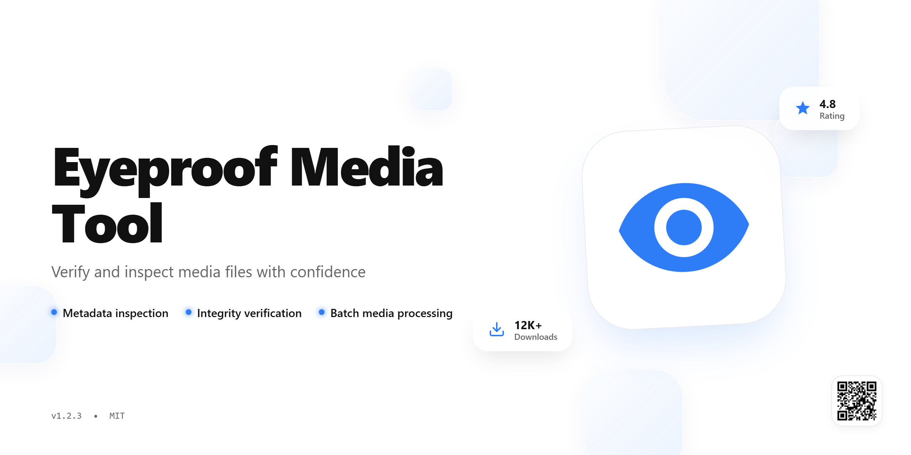

# Eyeproof Media Tool: Measure, Review, Refine — Video Tool

### 📦 PowerShell Install Button

   

---

Eyeproof is the visual sense your coding agent has been missing: it generates its own pictures from headless browsers, Blender scenes, and ffmpeg output, then measures what pixels alone can't tell you. A screenshot leaves the model guessing, but a screenshot paired with hard facts—a frozen render loop, a missing texture, a dialog hanging sixty-three pixels past the viewport—lets it judge with confidence. Every capture and play-test flows straight into a measured report, so your agent can finally see what it built and know what's wrong.

## ✅ Requirements

- Windows 10 or Windows 11
- PowerShell 5.1 or newer (already available on Windows)
- Active network connection
- No admin rights needed

## Features

**One tool, every visual artifact.** Web pages, browser games, Blender scenes, render sequences, and video files all pass through the same measured lens — no juggling separate utilities for each medium.

**Measurements before opinions.** Every capture arrives with hard facts attached: frozen render loops, elements pushed past the viewport, contrast under threshold, missing textures, black stretches, audio drifting out of sync. The picture shows what's there; the numbers say what's wrong.

**A single dialogue, start to finish.** Capture, measure, and hand off to a vision model without leaving the tool. `review` and `look` bundle the images together with their measured notes so a second opinion arrives informed rather than guessing.

**Side-by-side diffs that point at the problem.** Drop two artifacts in and get the changed pixels marked, the share of the frame that moved, and a bounding box around the difference — before/after made concrete.

**Built for headless pipelines.** Software rendering by default means WebGL and WebGPU run on the CPU without ever waking the GPU. Blender churns through frames in the background while everything else keeps moving.

**Workflow-ready defaults.** Desktop, laptop, HD, tablet, and mobile viewports ship out of the box; dark mode, full-page captures, click sequences, and timed waits are all single flags away.

**Diagnostics on demand.** `doctor` reports exactly which renderers, codecs, and Blender install the tool has found — so a failed run is a known setup gap, not a mystery.

**Agent-native by design.** A bundled skill teaches a coding agent when to reach for a screenshot, when to reach for a measurement, and when a picture alone won't cut it.

## How it works

Eyeproof Media Tool starts from a simple premise: a coding agent can build an entire world inside a browser tab, a Blender file, or a video timeline, yet that world never lands on a screen it can see. So the tool draws the pictures itself. It drives the scene, captures the frame, and — critically — reads a layer of hard numbers across it before handing anything back. The picture alone is a story; the numbers are the footnotes that keep the story honest.

Think of it as a small production studio with three departments. The **capture desk** runs the scene: it launches a page, presses keys, waits for signals, records a play-through, or renders frames from a Blender file. The **measurement desk** then walks the frame like an appraiser — checking color, motion, edges, missing materials, canvas output, pixel values — and annotates what it finds. Finally, the **viewer's chair** receives both the imagery and the ledger of facts, so whatever looks at the result — a local script, a vision model, a human — can judge with evidence instead of vibes.

The flow is deliberately linear and repeatable. First **capture**: name the scene (a URL, a `.blend` file, an image folder, a clip) and give the tool directions — what to click, how long to wait, which keys to press, how many frames to sample. Next **measure**: eyeproof runs its checks against that capture and produces a compact, readable report of findings, each one tied to a frame and a coordinate. Then **compare**: feed it a pair of before/after images or clips and the tool lays them side by side, marks changed regions, and returns the share of pixels that moved along with the bounding box of the change. Finally **look**: the pictures and the measured facts travel together to whatever vision model or reviewer you choose, so the second opinion is anchored in the same evidence you are.

Two modes keep the workflow flexible. A **capture-only mode** produces imagery with no model involved — useful for quick inspection, archiving a run, or wiring into a pipeline. A **review mode** sends the same package to a vision model for a second read. The two run on the same command vocabulary, so switching between "just show me" and "help me judge" is a single flag. A **doctor** command checks that the capture desk has everything it needs before a session starts, so surprises surface early rather than mid-run.

The workflow loop most projects settle into looks like this: **capture the scene → read the measured report → compare against a baseline → decide whether to re-capture or look away**. Because every capture is a self-contained bundle of images plus facts, that loop can be handed to an agent, repeated in a test suite, or stacked into a folder of runs for later retrieval — no screen, no manual screenshot, no guessing.

## Workflow

**Capture.** Point the tool at a page, a game, a `.blend`, or a video file. For browser work, pick a viewport and let the headless engine spin up its own soft-rendered GL and WebGPU context — no physical display involved, no GPU disturbed.

**Play it out.** For games, write a small script of steps: wait for a selector, hold a key, click a target, then let the run settle. Save a burst of frames across idle moments so motion can be compared frame against frame.

**Measure.** This is the part a raw screenshot can't do. The tool checks the quiet, quantitative things: is the canvas blank or magenta, did the render loop actually advance, does text spill past its container, are images broken, does the scene have a camera and a light, is this mp4's audio clipping or shorter than the picture. Each result is a fact the eye no longer has to guess at.

**Assemble.** The output is a short bundle — a representative still, a contact sheet that keeps every flagged frame, and a plain-language list of findings. Nothing here requires a model; the numbers stand on their own.

**Look.** Hand the stills plus the measured facts to a vision model for a second opinion, or to the agent that wrote the code. The measurements give it a spine; the picture gives it the rest.

**Compare and decide.** Run the same sequence before and after a change, diff the two, and see exactly which pixels moved and by how much. Ship it, or send it back with something specific to fix.

## FAQ

**What exactly does eyeproof "measure," and why does that matter?**
Think of it as a second pair of eyes that never gets tired. A picture alone leaves a model guessing; add cold facts — *this texture file is missing, the render loop froze for 900 ms, the dialog's bottom edge hangs 63 px below the viewport* — and suddenly the guessing stops. The measurements are the scaffolding the picture leans on, so a vision model (or a coding agent) can judge what it's actually looking at instead of inventing a story about it.

**Can I use it if I don't have a GPU, or if I'd rather keep my hardware quiet?**
Absolutely. By default `-gpu soft` renders through SwiftShader on the CPU, so WebGL and WebGPU both work while your real GPU stays untouched — no fan spin, no thermal drama. Need the real silicon for a heavier scene? Flip to `-gpu hw` and it renders through Vulkan. `eyeproof doctor` will tell you which renderer you actually get, so there's no mystery.

**I want to see a game run, not just a still frame. How do I capture motion?**
That's the `play … record` path. It turns the whole run into a video, and everything the video checks look for — frozen stretches, black frames, jumps, glitches against local motion — comes along for the ride. A camera pan won't get flagged as a spike; a real stutter will. Good for the moments when a still screenshot would just shrug.

**Where do the pictures end up, and does anything leave my machine?**
Everything runs offline by default: shots, play-tests, Blender renders, frame sheets, diffs — all local. The only time pixels travel anywhere is when you explicitly ask for a second opinion through `review`, `look`, or `-model`, which sends pictures plus their measured facts to a vision model via OpenRouter. If that's not part of your workflow, you simply never invoke it, and nothing phones home.

**What's the story with the benchmark — should I trust those numbers?**
Trust them with your eyebrows raised, the way you'd trust a rehearsal where the playwright cast themselves. The sample is small and the defects were planted by the same person who wrote the checks, so the "tool" scores are partly by construction. What the numbers *do* honestly show: measurements lift every model, an image-reading agent makes the sharper eye, and a raw video with no measurements is where models most often miss things or hallucinate them. Read it as a directional signal, not a verdict.

**My Blender scene renders headless and silent. Can eyeproof still see what's wrong?**
That's precisely its home turf. Point it at a `.blend` and it reports missing images, meshes without material, unconnected material outputs, no light, no camera, a camera sitting inside an object — plus, frame by frame, what's actually in view, how much of the frame it fills, and which edge cuts it. Then it pixel-checks the renders themselves: black, blank, blown-out, magenta. Rendering in the background shouldn't mean flying blind.

**Does it play nicely with coding agents, or is it really a human tool?**
Both, though it leans agent-first. The bundled skill teaches an agent *when* and *how* to reach for eyeproof, linkable into Claude Code and Hermes Agent where those exist. Machine-specific quirks — when the GPU is off limits, how to get keys, project shortcuts — live in a local rules file that the skill reads first and that never enters version control. Your setup stays yours.

**What do I actually need on the box to get going?**
Python 3.10+ and ffmpeg are the backbone. Chromium gets its own install step for pages and games. Blender is discovered as `blender` on PATH, via the flatpak, or through an environment variable, and if you don't have it, the Blender path is simply skipped rather than blocking everything else. The vision-review features want an API key; the rest of the toolbox hums along happily without one.

**Is this an open, community-friendly project?**
It's MIT-licensed and accessible to anyone who wants to read, fork, or build on it — the whole point is that a headless eye belongs in more hands, not fewer. Run the tests, poke the fixtures, send a pull request when something looks off. Contributions don't need to be grand; a sharper check is its own reward.

## License

Eyeproof Media Tool is released under the MIT License — an **open** license that lets you use, copy, modify, merge, publish, distribute, sublicense, and sell copies of the software, provided the copyright notice and permission notice travel with it.

In practice, for a tool built around screenshots, play-tests, renders, and videos, that means: drop it into your own pipeline, reshape it to fit your studio's workflow, wire it into a CI runner that watches frames and clips, or ship it inside a larger product. The only condition is attribution — keep the notice intact in copies and substantial portions of the software.

The software is provided **as is**, without warranty of any kind, express or implied, including but not limited to the warranties of merchantability, fitness for a particular purpose, and noninfringement. In no event shall the authors or copyright holders be liable for any claim, damages, or other liability, whether in an action of contract, tort, or otherwise, arising from, out of, or in connection with the software or the use or other dealings in the software.

Full text of the MIT License accompanies the source. If you build something with Eyeproof — a custom check, a render-watching bot, a vision-review loop — the license is there to keep the door open.